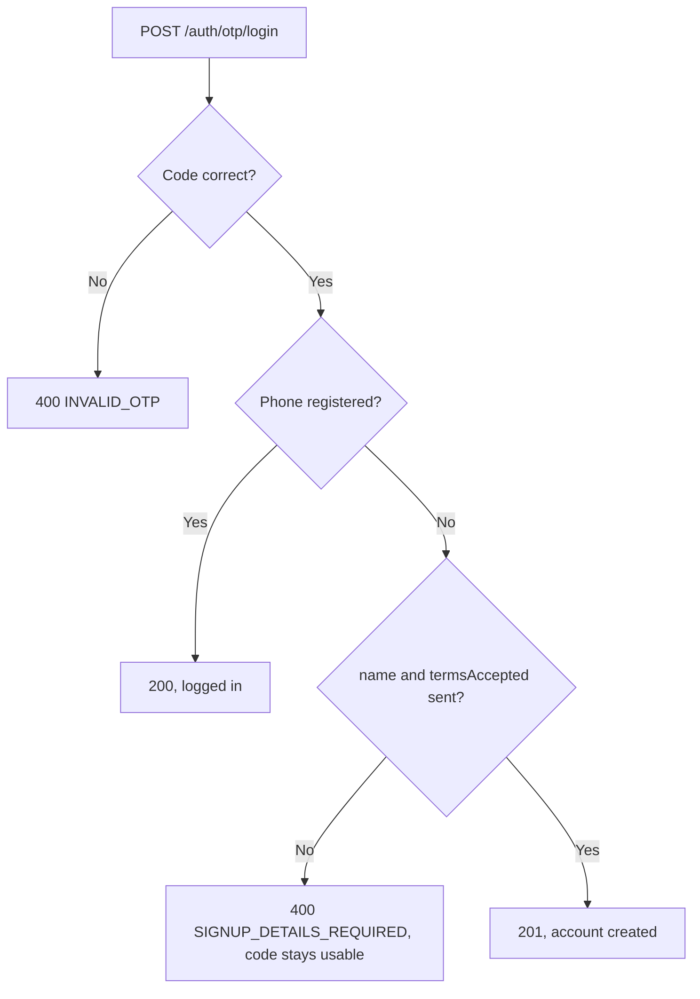
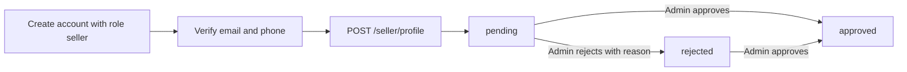

# Authentication

How login, sessions, roles and verification work in this backend. The code is the source of truth.

> Keep this file in sync with the code. Any change to auth behaviour, endpoints, limits or settings
> must update this document in the same change.

**Related:** [DATABASE.md](DATABASE.md) (tables), [ADDRESSES.md](ADDRESSES.md) (pickup address rules) and
[the Postman collection](../postman/Ecommerce-API.postman_collection.json) (runnable requests).

## Who can do what

| Method | Customer | Seller | Admin |
|---|---|---|---|
| Email + password login | Yes | Yes | Yes |
| Email OTP login | Yes | Yes | Yes |
| Phone OTP signup and login | Yes | Yes | No |
| Google signup and login | Yes | Yes | No |
| Public signup | Yes | Yes | No |

Every signup must send `termsAccepted: true`. Accounts need an email or a phone, and may have both.

## Sessions and tokens

A login returns `{ user, accessToken }` and sets a cookie.

| | Access token | Refresh token |
|---|---|---|
| Format | JWT (HS256) holding the user id and role | Random 32 bytes |
| Lifetime | 15 minutes (`JWT_ACCESS_EXPIRES_IN`) | 7 days (`REFRESH_TOKEN_EXPIRES_DAYS`) |
| Sent as | `Authorization: Bearer <token>` header | `refreshToken` cookie |
| Stored on the server | Not stored | SHA-256 hash in `refresh_tokens` |

The cookie is `HttpOnly` and `SameSite=Lax`, limited to the path `/api/auth`, and `Secure` when
`NODE_ENV=production`. Because of `SameSite=Lax`, the frontend and API must share a site in production
(for example `shop.com` and `api.shop.com`).

**Refreshing:** when an access token expires, the client calls `POST /api/auth/refresh`. The old refresh
token is revoked and a new one is issued, in one transaction, so a token works only once. If two tabs
refresh with the same token at once, one gets a 401.

**Logging out:** `logout` ends one session and `logout-all` ends all of them. An access token already
issued keeps working until it expires, because access tokens aren't stored.

**On every protected request**, `authenticate` loads the user from the database. Suspended, inactive or
deleted accounts are rejected straight away, and role changes apply immediately.

## Sign-in flows

### Email and password

1. `POST /auth/signup` creates the account, logs in and emails a verification code.
2. `POST /auth/otp/verify-email` verifies the email. Users can log in before verifying.
3. `POST /auth/login` logs in afterwards.

- Passwords are 8 characters to 72 bytes (bcrypt's limit), hashed with bcrypt at 12 rounds (`BCRYPT_SALT_ROUNDS`).
- Five failed logins lock the account for 15 minutes, even for the correct password.
- A wrong password and an unknown email give the same response and take similar time.
- Signup does return 409 for a taken email, which reveals that the email is registered.

### Email OTP login

1. `POST /auth/otp/send` with `channel: "email"` and `purpose: "login"`.
2. `POST /auth/otp/login` with the code.

This never creates an account. A successful login clears any password lock.

### Phone OTP signup and login

1. `POST /auth/otp/send` with `channel: "phone"` and `purpose: "login"`.
2. `POST /auth/otp/login` with the code.



A phone account has no email or password until the user adds them. Admin numbers never receive a login code.

### Google

The frontend gets an ID token from Google and sends it to `POST /auth/google`. The backend verifies its
signature, its expiry and that it was issued for `GOOGLE_CLIENT_ID`. A Google email that isn't verified is refused.

| Situation | Result |
|---|---|
| This Google account is already linked | Logs in (200) |
| Email matches a verified account | Links Google and logs in (200); the password keeps working |
| Email matches an unverified account | Links Google and logs in (200), with the takeover protection below |
| New user with `termsAccepted: true` | Creates a verified account (201) |
| New user without terms | 400 `TERMS_REQUIRED` |
| Admin account | 403 `METHOD_NOT_ALLOWED`, not linked |

`role` only applies when the account is created, so a returning user can't change their role with it.
An account can have one linked Google identity; a second returns 409.

### Password reset

1. `POST /auth/otp/send` with `purpose: "reset_password"`.
2. `POST /auth/password/reset` with the code and new password.

This also verifies the email, clears any lock and ends every session, so the user must log in again.
A Google or email-based account with no password can use this to set one.

## Verifying and adding contact details

| Goal | Endpoints | Login needed |
|---|---|---|
| Verify the email on an account | `POST /auth/otp/send` (`verify_email`), then `POST /auth/otp/verify-email` | No |
| Verify the account's email, or add one if it has none | `POST /auth/email/send-verification`, then `POST /auth/email/verify` | Yes |
| Add or replace the phone | `POST /auth/phone/send-verification`, then `POST /auth/phone/verify` | Yes |

A phone is saved only after its code is checked, so a stored phone is always verified. Changing an
existing email isn't supported.

## Sellers



A seller needs both email and phone verified before creating a profile, otherwise the request returns
403 `SELLER_VERIFICATION_REQUIRED` with what's missing in `details`.

| Signup method | Email | Phone |
|---|---|---|
| Email + password | Verify with OTP | Add and verify with OTP |
| Google | Already verified | Add and verify with OTP |
| Phone OTP | Add and verify with OTP | Already verified |

Each seller has one profile. Sellers can't set their own status or commission, and a pickup address must
be their own. `GET /seller/profile` shows their status, any rejection reason and their full `pickupAddress`.

`PATCH /seller/profile` edits the profile, and sending `null` clears an optional field:

| Current status | Editing | Result |
|---|---|---|
| `pending` | Anything | Stays `pending` |
| `approved` | Storefront details | Stays `approved` |
| `approved` | Legal details: `legalBusinessName`, `businessType` or `taxId` | Back to `pending` for review |
| `rejected` | Anything | Back to `pending`, reason cleared |
| `suspended` | Anything | 409 `PROFILE_SUSPENDED` |

`taxId` is the seller's GSTIN. It's optional, and only its format is checked, not whether it's real. Gaining or losing
one also returns the seller's published products to `draft`; see [CATALOG.md](CATALOG.md).
 Only approved sellers should list products, which must be enforced when products are added.

## Admins

- The first admin is created with `npm run create-admin`, which refuses to run if an admin already exists.
  It asks for the details, or reads `ADMIN_NAME`, `ADMIN_EMAIL` and `ADMIN_PASSWORD`.
- Other admins are created with `POST /admin/admins`.
- Admin emails start verified, and terms are recorded as accepted at creation because the database requires them.
- Admins review sellers with `GET /admin/sellers` and `PATCH /admin/sellers/:id/verification`.
  Pending and rejected profiles can be reviewed; an approved one returns 409 `INVALID_STATUS_CHANGE`.

## OTP rules

| Rule | Value |
|---|---|
| Code | 6 random digits |
| Expiry | 5 minutes |
| Guesses per code | 5 (every check counts, including correct ones) |
| Resend cooldown | 60 seconds per target and purpose |
| Sends | 5 per hour per target and purpose |
| Purposes | `verify_email`, `verify_phone`, `login`, `reset_password` |

- Only the newest code works, and a code works once.
- Codes are stored as an HMAC-SHA-256 hash bound to the target and purpose, so a code for one purpose can't
  be used for another. The key is `JWT_ACCESS_SECRET`, so changing that secret cancels active codes
  and invalidates issued access tokens.
- **Public `POST /auth/otp/send`** always returns the same 200 and sends in the background. The response never
  reveals whether an account exists, whether a code was sent, or whether a limit was hit. The frontend runs its
  own timer from `resendAfterSeconds`. A delivery failure only appears in the server log.
- **Logged-in send endpoints** wait for delivery and return real errors: 429 `OTP_COOLDOWN`, 429 `OTP_LIMIT` or
  502 `OTP_DELIVERY_FAILED`.

Public sends only go out in these cases:

| Request | Sent when |
|---|---|
| Email `verify_email` | The account is active and its email is unverified |
| Email `login` or `reset_password` | The account is active |
| Phone `login` | The number is new, or belongs to an active non-admin account |

## Rate limits

Limits apply per IP. This table covers `/api/auth` routes; public catalog limits are in [CATALOG.md](CATALOG.md). IPv6 clients are grouped by /56 range.

| Limit | Allowed | Routes |
|---|---|---|
| All requests | 300 per 15 min | Everything under `/api/auth` |
| Failed attempts (successes don't count) | 30 per 15 min, shared | `login`, `otp/login`, `otp/verify-email`, `password/reset`, `email/verify`, `phone/verify`, `google` |
| Signups | 20 per hour | `signup` |
| OTP sends | 20 per hour, shared | `otp/send`, `email/send-verification`, `phone/send-verification` |

Going over returns 429 `RATE_LIMITED` with a `Retry-After` header. Counters are held in memory, so they reset on
restart and aren't shared between server instances. Limits are in `src/middlewares/rateLimit.js`.

## Protection against email takeover

Someone could sign up with another person's email and a password, then wait for that person to start using the
account. To stop this, the first time an unverified email is proven through Google or email OTP login, the
account's password is cleared and all its sessions end. A real user in this position sets a password again with
password reset. Verifying through the normal verification code doesn't clear anything.

## Endpoints

All paths start with `/api`.

| Method and path | Access | Purpose |
|---|---|---|
| `GET /health` | Public | Server and database status |
| `POST /auth/signup` | Public | Sign up with email and password |
| `POST /auth/login` | Public | Log in with email and password |
| `POST /auth/refresh` | Cookie | Get a new access token |
| `POST /auth/logout` | Cookie | End this session |
| `POST /auth/logout-all` | Login | End every session |
| `GET /auth/me` | Login | Get the current user |
| `POST /auth/otp/send` | Public | Send a code |
| `POST /auth/otp/verify-email` | Public | Verify an email |
| `POST /auth/otp/login` | Public | Log in with a code; a new phone signs up |
| `POST /auth/password/reset` | Public | Set a new password with a code |
| `POST /auth/email/send-verification` | Login | Send a code to verify or add an email |
| `POST /auth/email/verify` | Login | Verify or add the email |
| `POST /auth/phone/send-verification` | Login | Send a code to add a phone |
| `POST /auth/phone/verify` | Login | Add the phone |
| `POST /auth/google` | Public | Sign up or log in with Google |
| `POST /seller/profile` | Seller | Create the store profile |
| `GET /seller/profile` | Seller | See my profile and approval status |
| `PATCH /seller/profile` | Seller | Edit my profile |
| `POST /admin/admins` | Admin | Create another admin |
| `GET /admin/sellers` | Admin | List profiles; `?status=` defaults to `pending` |
| `PATCH /admin/sellers/:id/verification` | Admin | Approve or reject a profile |

Request bodies are in `src/validators/` and the Postman collection.

## Errors

```json
{ "message": "Validation failed", "code": "VALIDATION_ERROR", "details": [{ "field": "email", "message": "Enter a valid email address" }] }
```

`message` is always present; `code` and `details` aren't. Frontends should act on `code`, not the message text.
In development, 5xx responses also include `stack`. Elsewhere, unexpected errors only say `Internal Server Error`.

| Status | Code | Meaning |
|---|---|---|
| 400 | `VALIDATION_ERROR` | Invalid input; see `details` |
| 400 | `INVALID_OTP` | Code is wrong, expired, used or out of attempts |
| 400 | `SIGNUP_DETAILS_REQUIRED` | New phone signup without `name` and `termsAccepted`; the code stays usable |
| 400 | `TERMS_REQUIRED` | New Google signup without terms |
| 400 | `INVALID_PICKUP_ADDRESS` | Address isn't the seller's own |
| 400 | `PICKUP_STATE_MISMATCH` | The pickup address isn't in the GSTIN's state |
| 401 | `UNAUTHORIZED` | Missing or invalid access token, or the account is no longer active |
| 401 | `INVALID_CREDENTIALS` | Wrong email or password |
| 401 | `INVALID_REFRESH_TOKEN` | Refresh cookie is missing, invalid, expired or already used |
| 401 | `INVALID_GOOGLE_TOKEN` | Google rejected the token |
| 401 | `GOOGLE_EMAIL_UNVERIFIED` | Google says the email isn't verified |
| 403 | `FORBIDDEN` | Wrong role for this route |
| 403 | `ACCOUNT_INACTIVE` | Account is suspended or inactive |
| 403 | `METHOD_NOT_ALLOWED` | Admins can't use Google |
| 403 | `SELLER_VERIFICATION_REQUIRED` | Seller's email or phone isn't verified |
| 404 | `NOT_FOUND` | Seller profile doesn't exist |
| 409 | `CONFLICT` | Email, phone, store URL or profile already exists |
| 409 | `EMAIL_ALREADY_SET` | Account already has a different email |
| 409 | `EMAIL_ALREADY_VERIFIED` | Email is already verified |
| 409 | `INVALID_STATUS_CHANGE` | Profile has already been approved |
| 409 | `PROFILE_SUSPENDED` | A suspended profile can't be edited |
| 409 | `PICKUP_ADDRESS_REQUIRED` | A store with published or paused products can't clear its pickup address |
| 429 | `ACCOUNT_LOCKED` | Too many failed logins on this account |
| 429 | `RATE_LIMITED` | Too many requests from this IP |
| 429 | `OTP_COOLDOWN` | Wait before requesting another code |
| 429 | `OTP_LIMIT` | Too many codes this hour |
| 502 | `OTP_DELIVERY_FAILED` | The email or SMS provider failed |
| 503 | `GOOGLE_NOT_CONFIGURED` | `GOOGLE_CLIENT_ID` isn't set |

## Settings

Set these in `.env`; see `.env.example`.

| Setting | Default | Purpose |
|---|---|---|
| `JWT_ACCESS_SECRET` | Required | Signs access tokens and keys OTP hashes |
| `JWT_ACCESS_EXPIRES_IN` | `15m` | Access token lifetime |
| `REFRESH_TOKEN_EXPIRES_DAYS` | `7` | Session lifetime |
| `BCRYPT_SALT_ROUNDS` | `12` | Password hashing cost |
| `TERMS_VERSION` | `v1` | Terms version recorded at signup |
| `CLIENT_URL` | `http://localhost:3000` | Frontend origin allowed by CORS |
| `TRUST_PROXY` | `0` | Number of reverse proxies in front of the app |
| `EMAIL_DRIVER` | `console` | `console` or `resend` |
| `EMAIL_FROM`, `RESEND_API_KEY` | None | Required for `resend` |
| `SMS_DRIVER` | `console` | `console` or `fast2sms` |
| `FAST2SMS_API_KEY` | None | Required for `fast2sms` |
| `GOOGLE_CLIENT_ID` | None | Google login returns 503 without it. The client secret isn't needed |

The `console` drivers print codes in the server terminal. The server refuses to start with them when `NODE_ENV=production`.

## Where the code is

| Location | Contents |
|---|---|
| `src/routes/auth.routes.js`, `seller.routes.js`, `admin.routes.js` | URLs and what runs on each |
| `src/controllers/auth.controller.js` | Email signup, login and sessions |
| `src/controllers/otp.controller.js` | OTP flows, password reset, adding an email or phone |
| `src/controllers/google.controller.js` | Google sign-in |
| `src/controllers/seller.controller.js`, `admin.controller.js` | Seller onboarding, admin actions |
| `src/middlewares/auth.js`, `validate.js`, `rateLimit.js`, `errorHandler.js` | Login and role checks, validation, limits, error format |
| `src/models/` | SQL for each table |
| `src/services/otp.service.js` | OTP rules |
| `src/services/email/`, `sms/`, `google.js` | External providers |
| `src/utils/password.js`, `token.js`, `otp.js`, `session.js` | Hashing, tokens, code generation, starting sessions |
| `src/validators/` | Request rules |
| `scripts/create-admin.js` | Creates the first admin |
| `tests/auth.test.js` | API tests |

## Testing

`npm test` needs `TEST_DATABASE_URL` pointing at a disposable database that has been migrated. **The tests delete
its data**, and they refuse to run if it matches `DATABASE_URL`.

## Known limitations

- **Providers not yet tried live:** a real Google login and real sending through Resend and Fast2SMS have not been tested.
- **SMS is India-only:** Fast2SMS delivers only to `+91` numbers. Sellers elsewhere can't complete phone verification.
- **SMS costs:** IP limits don't stop an attacker using many IPs. There is no overall daily SMS cap.
- **Refresh token reuse:** a reused token is rejected, but the session it was replaced by stays active.
- **Multiple servers:** rate limits need a shared store such as Redis.
- **Missing endpoints:** seller suspension,
  changing email or password while logged in, and removing a linked Google account.
- **Cleanup:** old OTP rows and expired sessions are only purged during later sends and logins by the same user or target.
