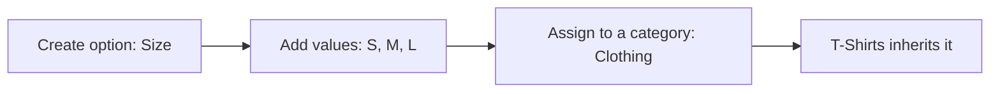
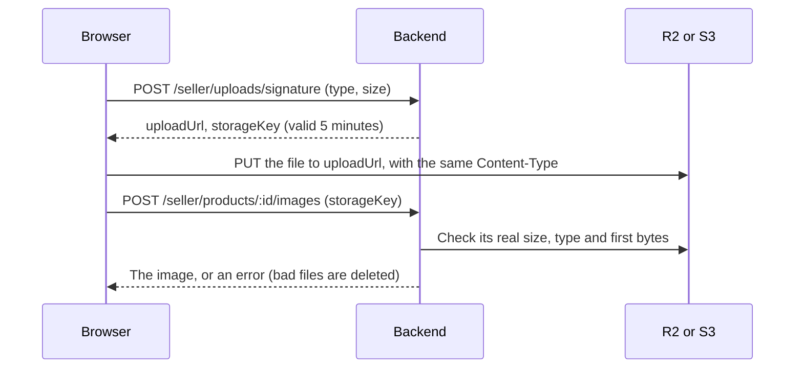
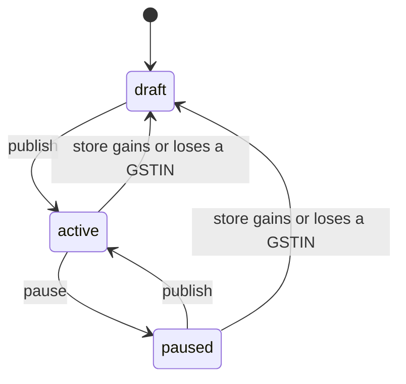

# Catalog

How categories, brands, variant options and sellers' products work. The code is the source of truth.

> Keep this file in sync with the code. Any change to catalog behaviour, endpoints, limits or error codes
> must update this document in the same change.

**Related:** [DATABASE.md](DATABASE.md) (tables), [AUTH.md](AUTH.md) (login and roles) and
[the Postman collection](../postman/Ecommerce-API.postman_collection.json) (runnable requests).

**Built so far:** categories, brands, variant options, sellers creating, editing and deleting products and variants, stock changes, image uploads, publishing, public browsing and search, and admin moderation.

## Categories

Admins create categories through the API, so a new category needs no code change. They form a tree of at most 3 levels,
for example Electronics → Mobiles → Smartphones.

- **Slug:** made from the name if not sent. A name with no English letters or numbers, such as one in Hindi script, must send its own.
- **Names:** unique under the same parent, so "Mobiles" can exist under two different parents, each with its own slug.
- **Moving:** change `parentId`, or set it to `null` for the top level. A move is refused if it would go past 3 levels, or put a category under itself or its descendants.
- **Products:** sit only on categories with no children, so a category with products can't get sub-categories.
- **Deleting:** soft delete, refused while it has sub-categories or products. Deactivate it instead to hide it and keep its data.
- **Inactive:** hides the category and everything below it from customers. Admins still see it.

Only one change to the tree runs at a time, so two admins moving categories at once can't create a loop. Creating a product takes the same lock in shared mode, so a product and a new sub-category can't land on one category at the same moment.

## Variant options

Admins define what variants can choose, such as Size or RAM, and which categories use them. New options need no code change.



| Category | Options | Example variant |
|---|---|---|
| Clothing | Size, Colour | `{"size": "m", "colour": "red"}` |
| Smartphones | RAM, Storage, Colour | `{"ram": "8gb", "storage": "128gb", "colour": "black"}` |
| Books | None | `{}` |

- **Codes never change:** variants store each option's and value's `code`, so a name or label can be edited safely. Sending `code` in an edit returns 400. A code is made from the name or label if not sent.
- **Inheritance:** a category uses its own options plus its parents'. If both set the same option, the setting closest to the category wins, so T-Shirts can make Clothing's required Size optional. `inherited` in the response shows where each came from.
- **Assigning:** `PUT` replaces the options set directly on a category. Inherited ones aren't affected.
- **Custom values:** `allowCustomValues: true` lets sellers type their own value, for options such as colour. Sizes stay a fixed list.
- **Deleting a value:** new variants can't use it, and it leaves the public list. Existing variants keep their stored code.
- **Deleting an option:** refused while a live category uses it; remove it from those categories first. A new option could reuse a deleted option's code, so avoid doing that once variants exist.

## Brands

- Names are unique, ignoring case, and a slug is made from the name if not sent.
- Admins can create, edit and deactivate brands. Seller products will also add brands by name.
- Deleting is refused while live products use the brand; deactivate it instead.
- `GET /brands?q=ni` finds names starting with "ni", ignoring case. `%` and `_` are ordinary characters.

## Products and variants

A product is the listing; a variant is what's actually bought, with its own price and stock.

- **Who can use it:** sellers with a store profile. Sellers awaiting approval, or rejected, can prepare drafts. Suspended sellers can only read. Other sellers' products return 404.
- **Category:** must be active, with no sub-categories. A product can move category only if its variants fit the new one.
- **Brand:** send `brandName`. A match, ignoring case, is reused; otherwise a new brand is created. An inactive brand is refused. `null` removes it.
- **URL:** made from the title with a random ending, and it stays the same when the title changes.
- **Drafts can be incomplete:** see "Publishing" for what a published product needs.

### Variants

| Rule | Detail |
|---|---|
| Options | Must match the category: required ones present, no others, and allowed values only. `"M"` is stored as the code `m` |
| Custom values | Only where the option allows it, such as colour. "Midnight Blue" is stored as `midnight-blue`, with the label kept in `optionLabels`. Needs English letters or numbers |
| Removed values | A variant keeps a value an admin removed until its options change, but a new variant can't choose it |
| No options | A category with no options allows one variant per product, with empty `options` |
| Prices | Up to 2 decimals, with `sellingPrice` at most `mrp`. Returned as strings such as `"499.50"`, because decimals can't be held exactly as numbers |
| Discounts | Sellers lower `sellingPrice`. The percentage shown is worked out from `mrp` and `sellingPrice`, never stored |
| GST | One of 0, 0.25, 1.5, 3, 5, 18 or 40. A seller with no GSTIN must use 0. A seller with one must state it when creating a variant |
| SKU | Unique per seller, ignoring case. Two sellers can share one |
| Stock | Starts at 0 and can't be set here; see "Stock" |
| Limit | At most 100 variants per product |
| Deleting | A published product must keep at least one variant. Deleting frees the SKU and options for reuse |

`minPrice` on the product follows the lowest price among its live, active variants, and is `null` when there are none.

### Stock

Stock changes only through `POST /seller/variants/:id/stock`, and every change adds a row to its history, so stock always equals the sum of that history.

```json
{ "change": 50, "reason": "initial", "note": "First delivery" }
```

| Reason | Use | Change |
|---|---|---|
| `initial` | The first stock count; only allowed while the variant has no history | Positive |
| `restock` | New stock arrived | Positive |
| `correction` | Fixing a count, such as damaged or lost units | Positive or negative |

- **Parallel changes:** each one is a single database update, so none get lost, and stock can't go below 0 however many arrive together.
- **Limits:** one change is at most 10,000,000 either way, and stock can't exceed 1,000,000,000.
- **Repeated requests aren't detected:** if a client sends the same restock twice, it's counted twice. Frontends should disable the button while a request is running. The history shows what happened, and a correction fixes it.
- **Low stock:** variants return `isLowStock`, true at or below `lowStockThreshold` (default 5). Alerts aren't built yet.
- **History:** kept with the variant and hidden from the API once the variant is deleted.

## Images

Files live in Cloudflare R2 or AWS S3. `STORAGE_DRIVER` chooses where new uploads go, and each image records its provider,
so old images keep working and can still be deleted after a switch. **Until storage is set up, upload endpoints return
503 `STORAGE_NOT_CONFIGURED`. Everything else works without it.**



Large files go straight to storage, so they never pass through this server.

| Rule | Detail |
|---|---|
| Files | JPEG, PNG or WebP, at most 5 MB. SVG isn't allowed, because it can contain scripts |
| Checks | Size, type and first bytes are read from the stored file when attaching, because R2 can't enforce a size limit during upload, and a declared type can't be trusted |
| Ownership | Each seller uploads to their own folder and can only attach files from it |
| Limit | At most 8 images per product. One file can be attached once |
| Primary | The first image is primary. Setting another moves the flag, and deleting the primary promotes the next |
| Variants | An image can be tied to a variant on the same product. Deleting the variant keeps the image |
| Deleting | Also deletes the file. If that fails, the image is still removed and the failure logged. A published product must keep one image |

Category images and brand logos use `POST /admin/uploads/signature`; save the returned `publicUrl` as `imageUrl` or `logoUrl`. These aren't checked after upload, because admins are trusted.

**Setup, outside the code:**
1. Create a bucket, and an API token with read and write access to it.
2. Add a CORS rule allowing `PUT` from `CLIENT_URL`, with the `Content-Type` header.
3. Give the bucket a public address. R2's `r2.dev` addresses are rate-limited and for development only, so production needs a custom domain.
4. Set `STORAGE_DRIVER` and the matching settings in `.env`, listed in `.env.example`.

**Known gaps:**
- Nothing resizes images, so originals are served. The frontend should compress them before upload, or Cloudflare image transformations can be added later.
- Files uploaded but never attached stay in the bucket, and so do files of soft-deleted products. A scheduled cleanup can be added later.
- Store logos and banners are still plain URLs.

## Publishing



Status changes only through `POST /seller/products/:id/publish` and `/pause`. Publishing is immediate, with no admin review of each product; admins can block a product instead.

**To publish, the store must be approved, the product must not be blocked, and it needs:**

| Area | Required |
|---|---|
| Legal details | Generic name, country of origin, manufacturer's name and address |
| HSN code | Only if the store has a GSTIN |
| Category | Active, with no sub-categories |
| Variants | At least one active, and every active one needs net quantity, weight, length, width and height |
| GST rate | 0 on every active variant if the store has no GSTIN |
| Images | At least one |

A failed publish returns 400 `PRODUCT_NOT_READY`, with everything missing listed in `details`, so a seller can fix it all at once. Stock isn't required, so a published product can show as out of stock.

**Once published:**
- A product can't lose its legal details, or its HSN code if the store has a GSTIN.
- A variant can't lose its details, and a new or re-activated one must be complete. A variant can be inactive and incomplete.
- A product must keep one variant and one image. Pause it to take it off sale.

**GSTIN changes:** gaining or losing a GSTIN changes the tax on every product, so all the seller's published and paused products return to `draft`, and the store goes back for review. `PATCH /seller/profile` returns how many in `productsUnpublished`. Replacing one GSTIN with another leaves products published, though the store still goes back for review, which hides them.

A store's rate of 0 can't be checked for accuracy, so after gaining a GSTIN, sellers must update their variants' GST rates themselves; the HSN code is required, but a 0% rate is still accepted. Have the CA confirm how this should work.

## Browsing

Customers need no login to browse.

**A product appears only when all of these are true:**
- It's `active`, not blocked and not deleted
- Its seller is `approved`, and the seller's account is active
- Its category and every category above it are active
- It has an active variant and an image

This is checked on every read, so suspending a seller or hiding a category takes effect at once and undoing it brings the products back. A hidden product's page returns the same 404 as one that doesn't exist. Out-of-stock products stay visible, marked `inStock: false`. A deactivated brand doesn't hide its products.

### `GET /products`

| Parameter | Meaning |
|---|---|
| `q` | Search text, at most 100 characters. Blank means no search |
| `categoryId` | That category and everything below it |
| `brandId` | One or more brands, as `a,b` or repeated; at most 20 |
| `minPrice`, `maxPrice` | Rupees, limits included. Compared with the price shown, which is the cheapest active variant's |
| `inStock` | `true` keeps only products with an active variant in stock |
| `option` | `option:value` codes, as `size:m,size:l` or repeated; at most 20 |
| `sort` | `relevance`, `newest`, `price_asc`, `price_desc`. Defaults to `relevance` when searching, otherwise `newest` |
| `page`, `limit` | `page` at most 1000; `limit` at most 50, default 24 |

Filters combine, and unknown parameters such as tracking tags are ignored.

- **Search:** matches words in the title and generic name, including other forms ("mugs" finds "mug"), and allows typos in the title ("samsng" finds "Samsung"). It uses Postgres, in English. It doesn't search brand names or descriptions, so sellers should put the brand in the title. A close spelling can bring in a weaker match, such as "phone" also finding "Headphones"; the exact match ranks first.
- **Option filters:** values of one option are alternatives (M or L), and different options must all match. A single variant must match them all, along with `inStock`, so "size M, in stock" skips a product whose only size M is sold out.
- **Price filters:** use the price shown, so `minPrice=1000` skips a product shown at ₹500 even if its largest size costs ₹2,000.
- **Card price:** `price`, `mrp` and `discountPercent` come from the cheapest active variant, including an out-of-stock one. The discount is worked out from MRP and price, and rounded down so it's never overstated.

Each product has its id, slug, title, category, brand, store, price, MRP, discount, main image and `inStock`. The response also has `pagination: { page, limit, total }`.

### `GET /products/:slug`

Everything a product page needs: description, highlights, specifications, category, brand, variants, images, `legal` (generic name, country of origin, manufacturer, packer, importer), `returns`, warranty and `seller` (store and legal name, logo, support email and phone).

- `variants` has only those on sale, cheapest first, each with `options` as codes such as `{"size": "m"}`.
- `options` lists the choices for the variant picker, in the order the admin set: only values used by variants on sale, with readable labels and colours. A seller's custom value uses its own label, and a deleted value keeps its label.

**Hidden from customers:** exact stock (only `inStock`), SKU, barcode, HSN code, GST rate, weight and dimensions, GSTIN, payout and commission details, block details, and storage keys. Responses are built field by field, so a new column stays private until it's added on purpose.

**Speed:** tested on 100,000 products with 3 variants each. Every query tried took about 210 ms or less. The total count is the slowest part. Cursor pagination can follow if this becomes a problem.

## Moderation

Publishing has no review of each product, so admins can act afterwards: `POST /admin/products/:id/block` with a `reason`, and `/unblock`.

- **Blocking** hides a product from customers at once. Its `status` doesn't change.
- **Unblocking** returns it to that status, so a live product goes straight back on sale and a draft stays a draft. It still needs an approved seller and an active category to be seen.
- **Sellers** see `isBlocked` and `blockedReason` on their products, so the reason should say what to fix. They can't publish (403 `PRODUCT_BLOCKED`) or clear the block, but they can edit, pause or delete the product. An edit stays hidden until an admin unblocks, so admins should re-check the product first with `GET /admin/products/:id`.
- **Repeating:** blocking a blocked product, or unblocking one that isn't blocked, returns 409 `INVALID_STATUS_CHANGE` and changes nothing. To change a reason, unblock and block again.
- **Records:** only the current block is kept. Unblocking clears who, when and why, so there's no history of past blocks. A deleted product keeps its block in the database.
- **Not built:** sellers aren't emailed when blocked, and a seller could list a blocked product again as a new one.

`GET /admin/products` lists every seller's products in any status, except deleted ones, newest first, with the store's name and approval status. Filters: `status`, `blocked`, `sellerId`, `q` (part of a title, or an exact slug), `page`, `limit` (at most 100, default 50).

## Endpoints

All paths start with `/api`.

| Method and path | Access | Purpose |
|---|---|---|
| `GET /categories` | Public | Active categories as a tree |
| `GET /categories/:id/variant-options` | Public | Options and values a variant in this category can use, including inherited ones; 404 if the category or a parent is inactive |
| `GET /brands` | Public | Active brands by name; `q`, `page`, `limit` (at most 100, default 50) |
| `GET /products` | Public | Search, filter, sort and page through products on sale |
| `GET /products/:slug` | Public | One product on sale, with its variants, images, legal and seller details |
| `GET /admin/categories` | Admin | Every category as a flat list, including inactive |
| `POST /admin/categories` | Admin | Create a category |
| `PATCH /admin/categories/:id` | Admin | Edit or move a category; `null` clears an optional field |
| `DELETE /admin/categories/:id` | Admin | Soft delete a category |
| `PUT /admin/categories/:id/variant-options` | Admin | Replace the category's own options |
| `GET /admin/brands` | Admin | All brands, including inactive |
| `POST /admin/brands` | Admin | Create a brand |
| `PATCH /admin/brands/:id` | Admin | Edit a brand |
| `DELETE /admin/brands/:id` | Admin | Soft delete a brand |
| `GET /admin/variant-options` | Admin | All options with their values |
| `POST /admin/variant-options` | Admin | Create an option |
| `PATCH /admin/variant-options/:id` | Admin | Edit an option's name or `allowCustomValues` |
| `DELETE /admin/variant-options/:id` | Admin | Soft delete an option |
| `POST /admin/variant-options/:id/values` | Admin | Add a value |
| `PATCH /admin/variant-options/:id/values/:valueId` | Admin | Edit a value's label, colour or order |
| `DELETE /admin/variant-options/:id/values/:valueId` | Admin | Soft delete a value |
| `POST /seller/products` | Seller | Create a draft |
| `GET /seller/products` | Seller | My products, newest first; `status`, `page`, `limit` |
| `GET /seller/products/:id` | Seller | One of my products, with its variants |
| `PATCH /seller/products/:id` | Seller | Edit a product; `null` clears an optional field |
| `DELETE /seller/products/:id` | Seller | Soft delete a product and its variants |
| `POST /seller/products/:id/publish` | Approved seller | Put a draft or paused product on sale |
| `POST /seller/products/:id/pause` | Seller | Take a product off sale |
| `POST /seller/products/:id/variants` | Seller | Add a variant |
| `PATCH /seller/variants/:id` | Seller | Edit a variant |
| `DELETE /seller/variants/:id` | Seller | Soft delete a variant |
| `POST /seller/variants/:id/stock` | Seller | Change stock, with a reason |
| `GET /seller/variants/:id/stock-movements` | Seller | Stock history, newest first; `page`, `limit` |
| `POST /seller/uploads/signature` | Seller | Get a URL to upload one image |
| `POST /seller/products/:id/images` | Seller | Attach an uploaded image |
| `PATCH /seller/images/:id` | Seller | Edit an image's text, order or variant, or make it primary |
| `DELETE /seller/images/:id` | Seller | Delete an image and its file |
| `GET /admin/products` | Admin | Every seller's products in any status, including blocked |
| `GET /admin/products/:id` | Admin | One product, with all its variants and images |
| `POST /admin/products/:id/block` | Admin | Hide a product from customers, with a reason |
| `POST /admin/products/:id/unblock` | Admin | Remove a block |
| `POST /admin/uploads/signature` | Admin | Get a URL to upload a category image or brand logo |

Request bodies are in `src/validators/catalog.validator.js`, `src/validators/product.validator.js` and the Postman collection. Category image and brand logo fields hold an `http` or `https` URL.

## Rate limits

Public catalog routes allow 300 requests per minute per IP, because one page view makes several requests. Over the limit
returns 429 `RATE_LIMITED`. Upload URLs are limited to 300 per hour per IP, because files cost money. Other admin and seller routes need a login and aren't limited.

## Errors

Errors use the format in [AUTH.md](AUTH.md).

| Status | Code | Meaning |
|---|---|---|
| 400 | `VALIDATION_ERROR` | Invalid input, including a field that can't be edited |
| 400 | `INVALID_PARENT` | Parent doesn't exist, or the move would put a category under itself |
| 400 | `CATEGORY_TOO_DEEP` | The result would go past 3 levels |
| 400 | `INVALID_OPTION` | An assigned option doesn't exist |
| 400 | `INVALID_CATEGORY` | A product's category doesn't exist or is inactive |
| 400 | `CATEGORY_NOT_LEAF` | A product's category has sub-categories |
| 400 | `BRAND_INACTIVE` | The named brand has been deactivated |
| 400 | `LEGAL_DETAILS_REQUIRED` | A published product can't lose these details |
| 400 | `INVALID_VARIANT_OPTIONS` | Options don't match the category; see `details` |
| 400 | `PRICE_ABOVE_MRP` | Selling price is above MRP |
| 400 | `GST_NOT_ALLOWED` | A seller with no GSTIN must use a GST rate of 0 |
| 400 | `VARIANT_LIMIT_REACHED` | The product already has 100 variants |
| 400 | `STOCK_LIMIT_REACHED` | Stock would go above 1,000,000,000 |
| 400 | `INVALID_VARIANT` | This variant isn't on this product |
| 400 | `INVALID_UPLOAD` | The file isn't in your folder, or failed the image checks |
| 400 | `UPLOAD_NOT_FOUND` | No file has been uploaded for this key |
| 400 | `IMAGE_LIMIT_REACHED` | The product already has 8 images |
| 400 | `PRODUCT_NOT_READY` | Can't publish yet; see `details` |
| 400 | `VARIANT_DETAILS_REQUIRED` | A variant on a published product needs these details |
| 403 | `SELLER_PROFILE_REQUIRED` | Create a store profile first |
| 403 | `SELLER_NOT_APPROVED` | Only an approved store can publish |
| 403 | `PRODUCT_BLOCKED` | An admin has blocked this product |
| 403 | `PROFILE_SUSPENDED` | A suspended seller can only read |
| 404 | `NOT_FOUND` | The record doesn't exist, or belongs to another seller |
| 409 | `CONFLICT` | A name, slug, code, SKU or variant's options are taken, or a record is linked to other data |
| 409 | `CATEGORY_HAS_CHILDREN` | Move or delete its sub-categories first |
| 409 | `CATEGORY_HAS_PRODUCTS` | Can't delete it or give it sub-categories |
| 409 | `BRAND_IN_USE` | Products use this brand |
| 409 | `OPTION_IN_USE` | A category uses this option |
| 409 | `VARIANTS_DONT_FIT_CATEGORY` | Edit or remove these variants before moving the product |
| 409 | `LAST_VARIANT` | A published product must keep a variant |
| 409 | `INVALID_STATUS_CHANGE` | A draft can't be paused, a blocked product can't be blocked again, or a product that isn't blocked can't be unblocked |
| 409 | `LAST_IMAGE` | A published product must keep an image |
| 409 | `INSUFFICIENT_STOCK` | The change would take stock below 0 |
| 409 | `INITIAL_STOCK_ALREADY_SET` | This variant already has history; use `restock` or `correction` |
| 502 | `STORAGE_ERROR` | R2 or S3 couldn't be reached |
| 503 | `STORAGE_NOT_CONFIGURED` | Image storage isn't set up yet |

## Where the code is

| Location | Contents |
|---|---|
| `src/routes/catalog.routes.js`, `admin.routes.js` | Public and admin URLs |
| `src/controllers/category.controller.js` | Category tree rules and option assignment |
| `src/controllers/brand.controller.js`, `variantOption.controller.js` | Brands, options and values |
| `src/models/category.model.js` | SQL, including inherited options |
| `src/models/brand.model.js`, `variantOption.model.js` | SQL |
| `src/controllers/product.controller.js`, `stock.controller.js` | Sellers' products, variants and stock |
| `src/models/product.model.js`, `productVariant.model.js` | SQL |
| `src/models/stock.model.js` | The only code that changes stock |
| `src/middlewares/sellerProfile.js` | Requires a store, and refuses suspended sellers' changes |
| `src/controllers/image.controller.js`, `src/models/productImage.model.js` | Uploads and product images |
| `src/controllers/browse.controller.js`, `src/models/browse.model.js` | Public browsing, search and the visibility rules |
| `src/controllers/adminProduct.controller.js`, `src/models/adminProduct.model.js` | Admin product list, block and unblock |
| `src/services/storage/` | R2 and S3 drivers |
| `src/utils/imageFile.js` | Allowed image types and the file checks |
| `src/utils/variantOptions.js`, `gst.js` | Option checks and allowed GST rates |
| `src/validators/catalog.validator.js`, `product.validator.js` | Request rules |
| `tests/catalog.test.js`, `products.test.js`, `images.test.js`, `publish.test.js`, `browse.test.js`, `moderation.test.js` | API tests |
| `tests/storage.test.js` | The real storage code. Its upload tests run against an S3-compatible server when `TEST_S3_ENDPOINT`, `TEST_S3_ACCESS_KEY`, `TEST_S3_SECRET_KEY` and `TEST_S3_BUCKET` are set, and are skipped otherwise |
