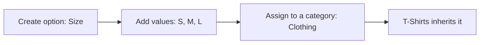

# Catalog

How categories, brands, variant options and sellers' products work. The code is the source of truth.

> Keep this file in sync with the code. Any change to catalog behaviour, endpoints, limits or error codes
> must update this document in the same change.

**Related:** [DATABASE.md](DATABASE.md) (tables), [AUTH.md](AUTH.md) (login and roles) and
[the Postman collection](../postman/Ecommerce-API.postman_collection.json) (runnable requests).

**Built so far:** categories, brands, variant options, sellers creating, editing and deleting products and variants, and stock changes. Images, publishing and public product browsing aren't built yet, so every new product stays a draft for now.

## Categories

Admins create categories through the API, so a new category needs no code change. They form a tree of at most 3 levels,
for example Electronics → Mobiles → Smartphones.

- **Slug:** made from the name if not sent. A name with no English letters or numbers, such as one in Hindi script, must send its own.
- **Names:** unique under the same parent, so "Mobiles" can exist under two different parents, each with its own slug.
- **Moving:** change `parentId`, or set it to `null` for the top level. A move is refused if it would go past 3 levels, or put a category under itself or its descendants.
- **Products:** sit only on categories with no children, so a category with products can't get sub-categories.
- **Deleting:** soft delete, refused while it has sub-categories or products. Deactivate it instead to hide it and keep its data.
- **Inactive:** hides the category and everything below it from customers. Admins still see it.

Only one change to the tree runs at a time, so two admins moving categories at once can't create a loop. Creating a product takes the same lock in shared mode, so a product and a new sub-category can't land on one category at the same moment.

## Variant options

Admins define what variants can choose, such as Size or RAM, and which categories use them. New options need no code change.



| Category | Options | Example variant |
|---|---|---|
| Clothing | Size, Colour | `{"size": "m", "colour": "red"}` |
| Smartphones | RAM, Storage, Colour | `{"ram": "8gb", "storage": "128gb", "colour": "black"}` |
| Books | None | `{}` |

- **Codes never change:** variants store each option's and value's `code`, so a name or label can be edited safely. Sending `code` in an edit returns 400. A code is made from the name or label if not sent.
- **Inheritance:** a category uses its own options plus its parents'. If both set the same option, the setting closest to the category wins, so T-Shirts can make Clothing's required Size optional. `inherited` in the response shows where each came from.
- **Assigning:** `PUT` replaces the options set directly on a category. Inherited ones aren't affected.
- **Custom values:** `allowCustomValues: true` lets sellers type their own value, for options such as colour. Sizes stay a fixed list.
- **Deleting a value:** new variants can't use it, and it leaves the public list. Existing variants keep their stored code.
- **Deleting an option:** refused while a live category uses it; remove it from those categories first. A new option could reuse a deleted option's code, so avoid doing that once variants exist.

## Brands

- Names are unique, ignoring case, and a slug is made from the name if not sent.
- Admins can create, edit and deactivate brands. Seller products will also add brands by name.
- Deleting is refused while live products use the brand; deactivate it instead.
- `GET /brands?q=ni` finds names starting with "ni", ignoring case. `%` and `_` are ordinary characters.

## Products and variants

A product is the listing; a variant is what's actually bought, with its own price and stock.

- **Who can use it:** sellers with a store profile. Sellers awaiting approval, or rejected, can prepare drafts. Suspended sellers can only read. Other sellers' products return 404.
- **Category:** must be active, with no sub-categories. A product can move category only if its variants fit the new one.
- **Brand:** send `brandName`. A match, ignoring case, is reused; otherwise a new brand is created. An inactive brand is refused. `null` removes it.
- **URL:** made from the title with a random ending, and it stays the same when the title changes.
- **Drafts can be incomplete:** a published product can't lose its generic name, country of origin or manufacturer details.

### Variants

| Rule | Detail |
|---|---|
| Options | Must match the category: required ones present, no others, and allowed values only. `"M"` is stored as the code `m` |
| Custom values | Only where the option allows it, such as colour. "Midnight Blue" is stored as `midnight-blue`, with the label kept in `optionLabels`. Needs English letters or numbers |
| Removed values | A variant keeps a value an admin removed until its options change, but a new variant can't choose it |
| No options | A category with no options allows one variant per product, with empty `options` |
| Prices | Up to 2 decimals, with `sellingPrice` at most `mrp`. Returned as strings such as `"499.50"`, because decimals can't be held exactly as numbers |
| Discounts | Sellers lower `sellingPrice`. The percentage shown is worked out from `mrp` and `sellingPrice`, never stored |
| GST | One of 0, 0.25, 1.5, 3, 5, 18 or 40. A seller with no GSTIN must use 0. A seller with one must state it when creating a variant |
| SKU | Unique per seller, ignoring case. Two sellers can share one |
| Stock | Starts at 0 and can't be set here; see "Stock" |
| Limit | At most 100 variants per product |
| Deleting | A published product must keep at least one variant. Deleting frees the SKU and options for reuse |

`minPrice` on the product follows the lowest price among its live, active variants, and is `null` when there are none.

### Stock

Stock changes only through `POST /seller/variants/:id/stock`, and every change adds a row to its history, so stock always equals the sum of that history.

```json
{ "change": 50, "reason": "initial", "note": "First delivery" }
```

| Reason | Use | Change |
|---|---|---|
| `initial` | The first stock count; only allowed while the variant has no history | Positive |
| `restock` | New stock arrived | Positive |
| `correction` | Fixing a count, such as damaged or lost units | Positive or negative |

- **Parallel changes:** each one is a single database update, so none get lost, and stock can't go below 0 however many arrive together.
- **Limits:** one change is at most 10,000,000 either way, and stock can't exceed 1,000,000,000.
- **Repeated requests aren't detected:** if a client sends the same restock twice, it's counted twice. Frontends should disable the button while a request is running. The history shows what happened, and a correction fixes it.
- **Low stock:** variants return `isLowStock`, true at or below `lowStockThreshold` (default 5). Alerts aren't built yet.
- **History:** kept with the variant and hidden from the API once the variant is deleted.

## Endpoints

All paths start with `/api`.

| Method and path | Access | Purpose |
|---|---|---|
| `GET /categories` | Public | Active categories as a tree |
| `GET /categories/:id/variant-options` | Public | Options and values a variant in this category can use, including inherited ones; 404 if the category or a parent is inactive |
| `GET /brands` | Public | Active brands by name; `q`, `page`, `limit` (at most 100, default 50) |
| `GET /admin/categories` | Admin | Every category as a flat list, including inactive |
| `POST /admin/categories` | Admin | Create a category |
| `PATCH /admin/categories/:id` | Admin | Edit or move a category; `null` clears an optional field |
| `DELETE /admin/categories/:id` | Admin | Soft delete a category |
| `PUT /admin/categories/:id/variant-options` | Admin | Replace the category's own options |
| `GET /admin/brands` | Admin | All brands, including inactive |
| `POST /admin/brands` | Admin | Create a brand |
| `PATCH /admin/brands/:id` | Admin | Edit a brand |
| `DELETE /admin/brands/:id` | Admin | Soft delete a brand |
| `GET /admin/variant-options` | Admin | All options with their values |
| `POST /admin/variant-options` | Admin | Create an option |
| `PATCH /admin/variant-options/:id` | Admin | Edit an option's name or `allowCustomValues` |
| `DELETE /admin/variant-options/:id` | Admin | Soft delete an option |
| `POST /admin/variant-options/:id/values` | Admin | Add a value |
| `PATCH /admin/variant-options/:id/values/:valueId` | Admin | Edit a value's label, colour or order |
| `DELETE /admin/variant-options/:id/values/:valueId` | Admin | Soft delete a value |
| `POST /seller/products` | Seller | Create a draft |
| `GET /seller/products` | Seller | My products, newest first; `status`, `page`, `limit` |
| `GET /seller/products/:id` | Seller | One of my products, with its variants |
| `PATCH /seller/products/:id` | Seller | Edit a product; `null` clears an optional field |
| `DELETE /seller/products/:id` | Seller | Soft delete a product and its variants |
| `POST /seller/products/:id/variants` | Seller | Add a variant |
| `PATCH /seller/variants/:id` | Seller | Edit a variant |
| `DELETE /seller/variants/:id` | Seller | Soft delete a variant |
| `POST /seller/variants/:id/stock` | Seller | Change stock, with a reason |
| `GET /seller/variants/:id/stock-movements` | Seller | Stock history, newest first; `page`, `limit` |

Request bodies are in `src/validators/catalog.validator.js`, `src/validators/product.validator.js` and the Postman collection. Image and logo fields hold an `http` or `https` URL for now; uploads arrive with image storage.

## Rate limits

Public catalog routes allow 300 requests per minute per IP, because one page view makes several requests. Over the limit
returns 429 `RATE_LIMITED`. Admin routes need a login and aren't limited.

## Errors

Errors use the format in [AUTH.md](AUTH.md).

| Status | Code | Meaning |
|---|---|---|
| 400 | `VALIDATION_ERROR` | Invalid input, including a field that can't be edited |
| 400 | `INVALID_PARENT` | Parent doesn't exist, or the move would put a category under itself |
| 400 | `CATEGORY_TOO_DEEP` | The result would go past 3 levels |
| 400 | `INVALID_OPTION` | An assigned option doesn't exist |
| 400 | `INVALID_CATEGORY` | A product's category doesn't exist or is inactive |
| 400 | `CATEGORY_NOT_LEAF` | A product's category has sub-categories |
| 400 | `BRAND_INACTIVE` | The named brand has been deactivated |
| 400 | `LEGAL_DETAILS_REQUIRED` | A published product can't lose these details |
| 400 | `INVALID_VARIANT_OPTIONS` | Options don't match the category; see `details` |
| 400 | `PRICE_ABOVE_MRP` | Selling price is above MRP |
| 400 | `GST_NOT_ALLOWED` | A seller with no GSTIN must use a GST rate of 0 |
| 400 | `VARIANT_LIMIT_REACHED` | The product already has 100 variants |
| 400 | `STOCK_LIMIT_REACHED` | Stock would go above 1,000,000,000 |
| 403 | `SELLER_PROFILE_REQUIRED` | Create a store profile first |
| 403 | `PROFILE_SUSPENDED` | A suspended seller can only read |
| 404 | `NOT_FOUND` | The record doesn't exist, or belongs to another seller |
| 409 | `CONFLICT` | A name, slug, code, SKU or variant's options are taken, or a record is linked to other data |
| 409 | `CATEGORY_HAS_CHILDREN` | Move or delete its sub-categories first |
| 409 | `CATEGORY_HAS_PRODUCTS` | Can't delete it or give it sub-categories |
| 409 | `BRAND_IN_USE` | Products use this brand |
| 409 | `OPTION_IN_USE` | A category uses this option |
| 409 | `VARIANTS_DONT_FIT_CATEGORY` | Edit or remove these variants before moving the product |
| 409 | `LAST_VARIANT` | A published product must keep a variant |
| 409 | `INSUFFICIENT_STOCK` | The change would take stock below 0 |
| 409 | `INITIAL_STOCK_ALREADY_SET` | This variant already has history; use `restock` or `correction` |

## Where the code is

| Location | Contents |
|---|---|
| `src/routes/catalog.routes.js`, `admin.routes.js` | Public and admin URLs |
| `src/controllers/category.controller.js` | Category tree rules and option assignment |
| `src/controllers/brand.controller.js`, `variantOption.controller.js` | Brands, options and values |
| `src/models/category.model.js` | SQL, including inherited options |
| `src/models/brand.model.js`, `variantOption.model.js` | SQL |
| `src/controllers/product.controller.js`, `stock.controller.js` | Sellers' products, variants and stock |
| `src/models/product.model.js`, `productVariant.model.js` | SQL |
| `src/models/stock.model.js` | The only code that changes stock |
| `src/middlewares/sellerProfile.js` | Requires a store, and refuses suspended sellers' changes |
| `src/utils/variantOptions.js`, `gst.js` | Option checks and allowed GST rates |
| `src/validators/catalog.validator.js`, `product.validator.js` | Request rules |
| `tests/catalog.test.js`, `tests/products.test.js` | API tests |
