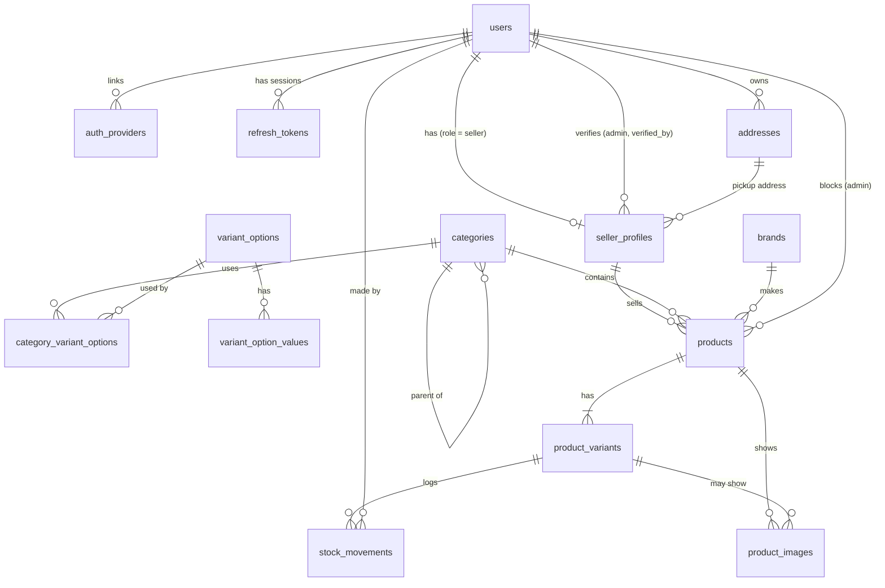

# Database Schema

PostgreSQL 18 (Docker container `ecommerce_db`, database `ecom_db`).
Source of truth is the SQL in `src/db/migrations/`. This document explains it:
what each table is for, how tables are grouped, and how they relate.

> Keep this file in sync with migrations. Every migration that adds or changes
> a table must update this document in the same change.

## Table groups\

| Group | Tables | Purpose |
|---|---|---|
| Identity & Access | `users`, `auth_providers`, `otp_codes`, `refresh_tokens` | Accounts for every role (customer, seller, admin), login and consent, linked external identities, one-time codes and sessions |
| Customer | `addresses` | Saved shipping/billing addresses (also used for seller pickup) |
| Seller | `seller_profiles` | Storefront, business/KYC, payout and approval details for sellers |
| Catalog | `categories`, `brands`, `variant_options`, `variant_option_values`, `category_variant_options` | What can be sold: the category tree, brands and the variant choices each category offers. Admin-managed |
| Products | `products`, `product_variants`, `product_images`, `stock_movements` | Sellers' listings, what's actually bought, photos and stock history |
| System | `schema_migrations` | Tracks which migration files have been applied (managed by `scripts/migrate.js`) |

## Relationships

| From | To | Type | FK column | On delete |
|---|---|---|---|---|
| `auth_providers` | `users` | many-to-one | `auth_providers.user_id` | CASCADE |
| `refresh_tokens` | `users` | many-to-one | `refresh_tokens.user_id` | CASCADE |
| `addresses` | `users` | many-to-one | `addresses.user_id` | CASCADE |
| `seller_profiles` | `users` | one-to-one | `seller_profiles.user_id` (UNIQUE) | CASCADE |
| `seller_profiles` | `users` (admin) | many-to-one | `seller_profiles.verified_by` | SET NULL |
| `seller_profiles` | `addresses` | many-to-one | `seller_profiles.pickup_address_id` | SET NULL |
| `categories` | `categories` (parent) | many-to-one | `categories.parent_id` | RESTRICT |
| `variant_option_values` | `variant_options` | many-to-one | `variant_option_values.option_id` | CASCADE |
| `category_variant_options` | `categories` | many-to-one | `category_variant_options.category_id` | CASCADE |
| `category_variant_options` | `variant_options` | many-to-one | `category_variant_options.option_id` | RESTRICT |
| `products` | `seller_profiles` | many-to-one | `products.seller_id` | RESTRICT |
| `products` | `categories` | many-to-one | `products.category_id` | RESTRICT |
| `products` | `brands` | many-to-one | `products.brand_id` | RESTRICT |
| `products` | `users` (admin) | many-to-one | `products.blocked_by` | SET NULL |
| `product_variants` | `products` | many-to-one | `product_variants (product_id, seller_id)` | CASCADE |
| `product_images` | `products` | many-to-one | `product_images.product_id` | CASCADE |
| `product_images` | `product_variants` | many-to-one | `product_images (variant_id, product_id)` | SET NULL on `variant_id` |
| `stock_movements` | `product_variants` | many-to-one | `stock_movements.variant_id` | CASCADE |
| `stock_movements` | `users` | many-to-one | `stock_movements.created_by` | SET NULL |

## Conventions (apply to every table)

- **Primary key:** `id UUID PRIMARY KEY DEFAULT uuidv7()`. Time-ordered, safe to expose in URLs.
- **Timestamps:** `created_at`, `updated_at` as `TIMESTAMPTZ NOT NULL DEFAULT NOW()`.
  Attach the shared `set_updated_at()` trigger so `updated_at` changes on every UPDATE.
- **Soft delete:** `deleted_at TIMESTAMPTZ` (NULL = live). Queries must filter `deleted_at IS NULL`.
  Unique indexes are partial (`WHERE deleted_at IS NULL`) so deleted rows don't block reuse.
- **Fixed value sets:** Postgres `ENUM` types (e.g. `user_role`).
- **Phone numbers:** E.164 format (`+919876543210`), enforced by CHECK constraint.
- **"Yes/no + when" flags:** a nullable timestamp (e.g. `email_verified_at`) rather than a boolean.
- **Money:** `NUMERIC`, never `FLOAT`.
- **Naming:** plural snake_case tables, `<table>_<column>_idx` indexes, `<table>_<rule>` constraints.

---

## Identity & Access

### `users`
Migrations: `20261101000100_create_users.sql`, `20261104120742_auth_schema.sql`

One row per account. Role decides what the account can do; role-specific data lives in
separate tables (e.g. `seller_profiles`).

| Column | Type | Notes |
|---|---|---|
| `id` | UUID | PK, `uuidv7()` |
| `name` | VARCHAR(100) | required |
| `email` | VARCHAR(255) | optional (phone-only accounts), unique case-insensitive among non-deleted users. CHECK: `email` or `phone` must be set |
| `phone` | VARCHAR(20) | optional, E.164, unique among non-deleted users |
| `avatar_url` | TEXT | |
| `password_hash` | TEXT | bcrypt hash, never plain text. NULL for Google and phone users |
| `role` | `user_role` | `customer` (default), `seller`, `admin` |
| `status` | `user_status` | `active` (default), `inactive`, `suspended` |
| `email_verified_at` | TIMESTAMPTZ | NULL = not verified |
| `phone_verified_at` | TIMESTAMPTZ | NULL = not verified |
| `terms_accepted_at` | TIMESTAMPTZ | required, cannot register without it |
| `terms_version` | VARCHAR(20) | which version of the terms was accepted |
| `marketing_opt_in` | BOOLEAN | default false, separate from terms |
| `last_login_at` | TIMESTAMPTZ | |
| `failed_login_count` | INTEGER | default 0, for lockout |
| `locked_until` | TIMESTAMPTZ | temporary lock after repeated failed logins |
| `created_at` / `updated_at` / `deleted_at` | TIMESTAMPTZ | standard |

**Rules (enforced in application code, not the DB)**
- Emails are stored lowercase.
- `users.phone` is only ever set after the number has been proven with an OTP.
- Signup always needs `termsAccepted: true`; public signup can only create `customer` or `seller`.
- Admins cannot log in with a phone OTP or Google.
- Five failed password logins set `locked_until` 15 minutes ahead.
- Taking over an unverified email (Google link or email OTP login) clears `password_hash` and revokes
  all sessions, so whoever registered that email without proving it loses access.

**Referenced by:** `auth_providers.user_id`, `refresh_tokens.user_id`, `addresses.user_id`, `seller_profiles.user_id`, `seller_profiles.verified_by`, `products.blocked_by`, `stock_movements.created_by`.

### `auth_providers`
Migration: `20261104120742_auth_schema.sql`

Links a user to an external identity (Google today).

| Column | Type | Notes |
|---|---|---|
| `id` | UUID | PK |
| `user_id` | UUID | FK → `users.id`, CASCADE. One identity per provider per user |
| `provider` | `auth_provider` | `google` |
| `provider_user_id` | VARCHAR(255) | provider's stable id (Google `sub`), unique per provider |
| `created_at` / `updated_at` | TIMESTAMPTZ | standard; no soft delete |

### `otp_codes`
Migration: `20261104120742_auth_schema.sql`

One-time codes for email and phone. Not linked to `users`: a phone signup has a code before it has a user.

| Column | Type | Notes |
|---|---|---|
| `id` | UUID | PK |
| `channel` | `otp_channel` | `email`, `phone` |
| `target` | VARCHAR(255) | lowercase email or E.164 phone |
| `purpose` | `otp_purpose` | `verify_email`, `verify_phone`, `login`, `reset_password` |
| `code_hash` | TEXT | HMAC-SHA-256 of the code, bound to target and purpose |
| `expires_at` | TIMESTAMPTZ | 5 minutes after creation |
| `attempts` | INTEGER | at most 5 |
| `consumed_at` | TIMESTAMPTZ | set when used, or when replaced by a newer code |
| `created_at` | TIMESTAMPTZ | no `updated_at` or soft delete; rows older than a day are purged on the next send |

**Rules (enforced in application code, not the DB)**
- Per target and purpose: one send every 60 seconds, at most 5 per hour. Only the newest code works.

### `refresh_tokens`
Migration: `20261104120742_auth_schema.sql`

One row per login session. Rotated on every refresh.

| Column | Type | Notes |
|---|---|---|
| `id` | UUID | PK |
| `user_id` | UUID | FK → `users.id`, CASCADE |
| `token_hash` | TEXT | SHA-256 of the cookie value, unique |
| `user_agent` | TEXT | device the session started on |
| `expires_at` | TIMESTAMPTZ | 7 days after creation (`REFRESH_TOKEN_EXPIRES_DAYS`) |
| `revoked_at` | TIMESTAMPTZ | set on rotation, logout and password reset |
| `created_at` | TIMESTAMPTZ | no `updated_at` or soft delete; expired rows are purged on the next login |

---

## Customer

### `addresses`
Migrations: `20261101045705_create_addresses.sql`, `20261105054731_addresses_for_india.sql`

A user's address book. Used for customer shipping/billing and seller pickup. India only for now.

| Column | Type | Notes |
|---|---|---|
| `id` | UUID | PK |
| `user_id` | UUID | FK → `users.id`, CASCADE |
| `label` | VARCHAR(50) | e.g. Home, Work, Warehouse |
| `full_name` / `phone` | VARCHAR | recipient; may differ from account holder. Phone required, E.164 |
| `address_line1` | VARCHAR(255) | required |
| `address_line2`, `landmark` | VARCHAR(255) | optional |
| `city`, `postal_code` | VARCHAR | required. An Indian PIN code is 6 digits, not starting with 0 (CHECK) |
| `state_code` | CHAR(2) | GST state code, e.g. `27`, required. Orders compare this to choose CGST + SGST or IGST |
| `state` | VARCHAR(100) | state name, filled in by the app from `state_code`, never sent by users |
| `country_code` | CHAR(2) | ISO 3166-1 alpha-2, default `IN` |
| `is_default_shipping` | BOOLEAN | at most one per user (partial unique index) |
| `is_default_billing` | BOOLEAN | at most one per user (partial unique index) |
| `created_at` / `updated_at` | TIMESTAMPTZ | standard. Hard deleted, unlike most tables, so unused personal data isn't kept |

**Rules**
- Orders must **copy** the address, including `state_code`, into the order when placed, not just reference
  `addresses.id`, so editing or deleting an address never changes a past order.
- `state_code` must come from `src/utils/indianStates.js`, which also supplies `state`.
- At most 20 addresses per user. A user's first address becomes both defaults, and deleting a default passes it to the newest address.
- Every change locks the user's row first (`FOR NO KEY UPDATE`).
- Switching the default: unset the old default before setting the new one (same transaction),
  otherwise the unique index rejects it.

**Referenced by:** `seller_profiles.pickup_address_id`.

---

## Seller

### `seller_profiles`
Migration: `20261101045706_create_seller_profiles.sql`

One profile per seller account (`users.role = 'seller'`).

| Column | Type | Notes |
|---|---|---|
| `id` | UUID | PK |
| `user_id` | UUID | FK → `users.id`, UNIQUE (one profile per user), CASCADE |
| `store_name` | VARCHAR(150) | public store name |
| `store_slug` | VARCHAR(160) | lowercase-hyphenated, unique among non-deleted; used in URLs |
| `description`, `logo_url`, `banner_url` | TEXT | storefront |
| `support_email` / `support_phone` | VARCHAR | customer-facing contact; phone E.164 |
| `business_type` | `seller_business_type` | `individual` (default), `company` |
| `legal_business_name` | VARCHAR(200) | required |
| `tax_id` | VARCHAR(50) | optional GSTIN, uppercase, format checked by the app |
| `pickup_address_id` | UUID | FK → `addresses.id`, SET NULL |
| `payout_account_id` | VARCHAR(100) | payment-provider account reference (Razorpay Route / Stripe Connect); never raw bank details |
| `verification_status` | `seller_verification_status` | `pending` (default), `approved`, `rejected`, `suspended` |
| `verified_at` | TIMESTAMPTZ | when an admin reviewed |
| `verified_by` | UUID | FK → `users.id` (the admin), SET NULL |
| `rejection_reason` | TEXT | required when status is `rejected` |
| `commission_rate` | NUMERIC(5,2) | platform fee %, default 10.00, 0–100 |
| `created_at` / `updated_at` / `deleted_at` | TIMESTAMPTZ | standard |

**Rules (enforced in application code, not the DB)**
- Only create a profile for a user whose `role = 'seller'` and whose email and phone are both verified.
- `verified_by` must be a user with `role = 'admin'`.
- `pickup_address_id` must belong to the same seller (`addresses.user_id = seller_profiles.user_id`).
- Only `approved` sellers may list products or receive orders.
- Editing a `rejected` profile, or the legal details of an `approved` one, returns it to `pending` and clears
  `rejection_reason`, `verified_at` and `verified_by`. `suspended` profiles can't be edited.
- Admins review `pending` or `rejected` profiles. An `approved` profile can't be rejected
  (`suspended` is for removing an approval, and has no endpoint yet).

**Referenced by:** `products.seller_id`.

---

## Catalog

Categories and variant options are data, not code: admins create them, so a new category or option needs no code change.

### `categories`
Migration: `20261104135523_create_categories.sql`

Admin-managed tree, for example Electronics → Mobiles → Smartphones.

| Column | Type | Notes |
|---|---|---|
| `id` | UUID | PK |
| `parent_id` | UUID | FK → `categories.id`, RESTRICT. NULL = top level. Can't be its own id |
| `name` | VARCHAR(100) | required, unique case-insensitive under the same parent among non-deleted |
| `slug` | VARCHAR(120) | lowercase-hyphenated, unique among non-deleted; used in URLs |
| `description`, `image_url` | TEXT | |
| `default_hsn_code` | VARCHAR(8) | 4, 6 or 8 digits; a suggestion for sellers only |
| `sort_order` | INTEGER | default 0 |
| `is_active` | BOOLEAN | default true |
| `created_at` / `updated_at` / `deleted_at` | TIMESTAMPTZ | standard |

**Rules (enforced in application code, not the DB)**
- At most 3 levels, and moving a category must not create a loop.
- Products attach only to a category with no children.
- A category with live products or children can't be deleted.
- Don't create food, medicine or similar categories until licence and expiry columns exist.

**Referenced by:** `categories.parent_id`, `category_variant_options.category_id`, `products.category_id`.

### `brands`
Migration: `20261104135523_create_brands.sql`

| Column | Type | Notes |
|---|---|---|
| `id` | UUID | PK |
| `name` | VARCHAR(100) | required, unique case-insensitive among non-deleted |
| `slug` | VARCHAR(120) | lowercase-hyphenated, unique among non-deleted |
| `logo_url` | TEXT | |
| `is_active` | BOOLEAN | default true |
| `created_at` / `updated_at` / `deleted_at` | TIMESTAMPTZ | standard |

**Rules (enforced in application code, not the DB)**
- When a seller types a brand name, reuse an existing match, otherwise create it.
- A brand with live products can't be deleted.

**Referenced by:** `products.brand_id`.

### `variant_options`
Migration: `20261104135523_create_variant_options.sql`

The kinds of choice a variant can have, such as Size, Colour or RAM.

| Column | Type | Notes |
|---|---|---|
| `id` | UUID | PK |
| `name` | VARCHAR(50) | shown to customers; can be renamed |
| `code` | VARCHAR(50) | e.g. `size`, unique among non-deleted |
| `allow_custom_values` | BOOLEAN | default false; true lets sellers type their own value, e.g. a colour |
| `created_at` / `updated_at` / `deleted_at` | TIMESTAMPTZ | standard |

**Rules (enforced in application code, not the DB)**
- `code` can't change after creation, because variants will store it.
- An option used by a live category can't be deleted.

**Referenced by:** `variant_option_values.option_id`, `category_variant_options.option_id`.

### `variant_option_values`
Migration: `20261104135523_create_variant_options.sql`

The allowed values of an option, such as S, M, L.

| Column | Type | Notes |
|---|---|---|
| `id` | UUID | PK |
| `option_id` | UUID | FK → `variant_options.id`, CASCADE |
| `label` | VARCHAR(50) | shown to customers; can be renamed |
| `code` | VARCHAR(50) | e.g. `m`, unique per option among non-deleted |
| `color_hex` | CHAR(7) | optional colour swatch, e.g. `#FF0000` |
| `sort_order` | INTEGER | default 0, so sizes show S, M, L rather than alphabetically |
| `created_at` / `updated_at` / `deleted_at` | TIMESTAMPTZ | standard |

**Rules (enforced in application code, not the DB)**
- `code` can't change after creation, because variants will store it.

### `category_variant_options`
Migration: `20261104135523_create_variant_options.sql`

Which options each category uses.

| Column | Type | Notes |
|---|---|---|
| `category_id` | UUID | PK with `option_id`; FK → `categories.id`, CASCADE |
| `option_id` | UUID | FK → `variant_options.id`, RESTRICT |
| `is_required` | BOOLEAN | default true; every variant must choose a value |
| `sort_order` | INTEGER | default 0 |
| `created_at` | TIMESTAMPTZ | no `updated_at` or soft delete; rows are removed when an admin changes the list |

**Rules (enforced in application code, not the DB)**
- A category uses its own options plus those of its parents. If both set the same option, the closest wins.

---

## Products

Prices are rupees and include GST. There is no currency column, because the shop is India-only.

### `products`
Migration: `20261104141114_create_products.sql`

The listing customers see. Enables the `pg_trgm` extension for typo-tolerant search.

| Column | Type | Notes |
|---|---|---|
| `id` | UUID | PK. Also unique with `seller_id`, for the variant FK |
| `seller_id` | UUID | FK → `seller_profiles.id`, RESTRICT |
| `category_id` | UUID | FK → `categories.id`, RESTRICT |
| `brand_id` | UUID | FK → `brands.id`, RESTRICT. NULL = unbranded |
| `title` | VARCHAR(200) | required |
| `slug` | VARCHAR(220) | lowercase-hyphenated, unique among non-deleted |
| `description` | TEXT | |
| `highlights` | TEXT[] | default empty; short bullet points |
| `specifications` | JSONB | default `{}`, must be an object; display only |
| `hsn_code` | VARCHAR(8) | 4, 6 or 8 digits |
| `generic_name` | VARCHAR(150) | e.g. "Men's T-Shirt" |
| `country_of_origin` | CHAR(2) | ISO code, uppercase, e.g. `IN` |
| `manufacturer_name` | VARCHAR(200) | |
| `manufacturer_address` | TEXT | |
| `packer_details`, `importer_details` | TEXT | optional |
| `is_returnable` | BOOLEAN | default true |
| `return_window_days` | SMALLINT | default 7; above 0 when returnable |
| `warranty_summary` | VARCHAR(255) | optional |
| `status` | `product_status` | `draft` (default), `active`, `paused` |
| `min_price` | NUMERIC(12,2) | lowest live variant price, for sorting and filtering |
| `search_vector` | TSVECTOR | generated from `title` and `generic_name` |
| `blocked_at`, `blocked_by`, `blocked_reason` | | admin moderation; `blocked_by` FK → `users.id`, SET NULL; a reason is required when blocked |
| `created_at` / `updated_at` / `deleted_at` | TIMESTAMPTZ | standard |

A non-draft product must have `generic_name`, `country_of_origin`, `manufacturer_name` and `manufacturer_address` (CHECK).

**Rules (enforced in application code, not the DB)**
- A product appears to customers only when: `status = 'active'`, not blocked or deleted; the seller is `approved` and their account active; the category and every category above it are active; and it has a live variant and an image. All public reads use `src/models/browse.model.js`, which applies these.
- Only `approved` sellers can publish, and sellers can only touch their own products. Sellers can't unblock a product. Blocking doesn't change `status`, and unblocking clears `blocked_at`, `blocked_by` and `blocked_reason`, so past blocks aren't kept. Suspended sellers can only read.
- Creating a product or changing its category takes the category tree lock in shared mode.
- Deleting a product also deletes its variants.
- `hsn_code` is required to publish, and to stay published, if the seller has a GSTIN.
- `status` changes only through publish and pause, and a seller gaining or losing a GSTIN returns their non-draft products to `draft`.
- Products attach only to a category with no children.
- Whenever a variant's price or status changes, recalculate `min_price` in the same transaction.
- Orders must **copy** title, price, GST rate and HSN code when placed, so later edits never change past orders.

**Referenced by:** `product_variants (product_id, seller_id)`, `product_images.product_id`.

### `product_variants`
Migration: `20261104141116_create_product_variants.sql`

What's actually bought. Every product has at least one; a product with no options has one with empty `options`.

| Column | Type | Notes |
|---|---|---|
| `id` | UUID | PK. Also unique with `product_id`, for the image FK |
| `product_id`, `seller_id` | UUID | composite FK → `products (id, seller_id)`, CASCADE, so a variant can't be under another seller's product |
| `sku` | VARCHAR(64) | seller's code, unique per seller, case-insensitive, among non-deleted |
| `options` | JSONB | default `{}`, option code → value code. Unique per product among non-deleted |
| `option_labels` | JSONB | default `{}`, labels for custom values only |
| `mrp` | NUMERIC(12,2) | above 0 |
| `selling_price` | NUMERIC(12,2) | above 0 and at most `mrp`; includes GST |
| `gst_rate` | NUMERIC(5,2) | default 0, 0–100 |
| `net_quantity` | VARCHAR(50) | e.g. "500 g" |
| `weight_grams` | INTEGER | above 0 |
| `length_mm`, `width_mm`, `height_mm` | INTEGER | above 0 |
| `stock_quantity` | INTEGER | default 0, can't be negative |
| `low_stock_threshold` | INTEGER | default 5 |
| `barcode` | VARCHAR(20) | optional GTIN/EAN, 8–14 digits |
| `is_active` | BOOLEAN | default true |
| `created_at` / `updated_at` / `deleted_at` | TIMESTAMPTZ | standard |

**Rules (enforced in application code, not the DB)**
- `net_quantity`, `weight_grams` and the dimensions are required on every active variant of a non-draft product.
- At most 100 per product. A published product must keep at least one.
- JSONB values must be sent with `JSON.stringify`, because the `pg` library turns a JavaScript array into a Postgres array.
- `options` must match the category's options and allowed values.
- `gst_rate` must be a current GST rate, and 0 for a seller with no GSTIN.
- Stock changes only through `src/models/stock.model.js`, which updates the variant and adds a `stock_movements` row in one transaction.

**Referenced by:** `product_images (variant_id, product_id)`, `stock_movements.variant_id`.

### `product_images`
Migration: `20261104141117_create_product_images.sql`

The file is in R2 or S3; this row records where.

| Column | Type | Notes |
|---|---|---|
| `id` | UUID | PK |
| `product_id` | UUID | FK → `products.id`, CASCADE |
| `variant_id` | UUID | composite FK with `product_id` → `product_variants (id, product_id)`, so it must be the same product. Deleting the variant clears this and keeps the image |
| `storage_provider` | `storage_provider` | `r2`, `s3` |
| `storage_key` | VARCHAR(255) | file path in the bucket, unique per provider |
| `url` | TEXT | required |
| `alt_text` | VARCHAR(200) | |
| `sort_order` | INTEGER | default 0 |
| `is_primary` | BOOLEAN | default false; at most one per product |
| `created_at` / `updated_at` | TIMESTAMPTZ | hard deleted: no `deleted_at` |

**Rules (enforced in application code, not the DB)**
- At most 8 images per product. A published product must keep at least one.
- A file is attached only after its size, type and first bytes are checked in storage.

### `stock_movements`
Migration: `20261104141118_create_stock_movements.sql`

History of every stock change. Rows are only ever added.

| Column | Type | Notes |
|---|---|---|
| `id` | UUID | PK |
| `variant_id` | UUID | FK → `product_variants.id`, CASCADE |
| `change` | INTEGER | positive or negative, not 0 |
| `quantity_after` | INTEGER | stock after this change, 0 or more |
| `reason` | `stock_movement_reason` | `initial`, `restock`, `correction` |
| `note` | VARCHAR(255) | |
| `created_by` | UUID | FK → `users.id`, SET NULL |
| `created_at` | TIMESTAMPTZ | no `updated_at` or soft delete |

**Rules (enforced in application code, not the DB)**
- `initial` is allowed only while a variant has no history. Only `correction` can remove stock.

---

## System

### `schema_migrations`
Created and managed by `scripts/migrate.js`. Do not edit by hand.

| Column | Type | Notes |
|---|---|---|
| `name` | TEXT | PK, migration filename |
| `applied_at` | TIMESTAMPTZ | when it was applied |
