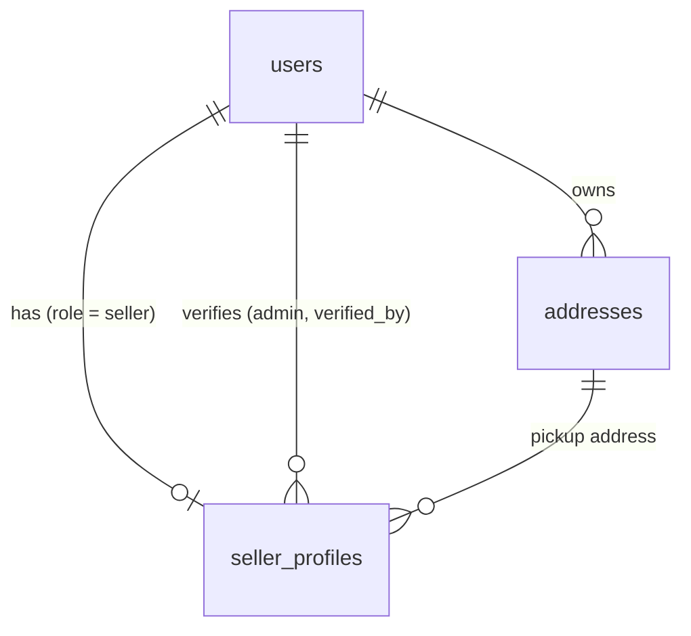

# Database Schema

PostgreSQL 18 (Docker container `ecommerce_db`, database `ecom_db`).
Source of truth is the SQL in `src/db/migrations/`. This document explains it:
what each table is for, how tables are grouped, and how they relate.

> Keep this file in sync with migrations. Every migration that adds or changes
> a table must update this document in the same change.

## Table groups

| Group | Tables | Purpose |
|---|---|---|
| Identity & Access | `users` | Accounts for every role (customer, seller, admin), login and consent |
| Customer | `addresses` | Saved shipping/billing addresses (also used for seller pickup) |
| Seller | `seller_profiles` | Storefront, business/KYC, payout and approval details for sellers |
| System | `schema_migrations` | Tracks which migration files have been applied (managed by `scripts/migrate.js`) |

## Relationships

| From | To | Type | FK column | On delete |
|---|---|---|---|---|
| `addresses` | `users` | many-to-one | `addresses.user_id` | CASCADE |
| `seller_profiles` | `users` | one-to-one | `seller_profiles.user_id` (UNIQUE) | CASCADE |
| `seller_profiles` | `users` (admin) | many-to-one | `seller_profiles.verified_by` | SET NULL |
| `seller_profiles` | `addresses` | many-to-one | `seller_profiles.pickup_address_id` | SET NULL |

## Conventions (apply to every table)

- **Primary key:** `id UUID PRIMARY KEY DEFAULT uuidv7()`. Time-ordered, safe to expose in URLs.
- **Timestamps:** `created_at`, `updated_at` as `TIMESTAMPTZ NOT NULL DEFAULT NOW()`.
  Attach the shared `set_updated_at()` trigger so `updated_at` changes on every UPDATE.
- **Soft delete:** `deleted_at TIMESTAMPTZ` (NULL = live). Queries must filter `deleted_at IS NULL`.
  Unique indexes are partial (`WHERE deleted_at IS NULL`) so deleted rows don't block reuse.
- **Fixed value sets:** Postgres `ENUM` types (e.g. `user_role`).
- **Phone numbers:** E.164 format (`+919876543210`), enforced by CHECK constraint.
- **"Yes/no + when" flags:** a nullable timestamp (e.g. `email_verified_at`) rather than a boolean.
- **Money:** `NUMERIC`, never `FLOAT`.
- **Naming:** plural snake_case tables, `<table>_<column>_idx` indexes, `<table>_<rule>` constraints.

---

## Identity & Access

### `users`
Migration: `20261101000100_create_users.sql`

One row per account. Role decides what the account can do; role-specific data lives in
separate tables (e.g. `seller_profiles`).

| Column | Type | Notes |
|---|---|---|
| `id` | UUID | PK, `uuidv7()` |
| `name` | VARCHAR(100) | required |
| `email` | VARCHAR(255) | required, unique case-insensitive among non-deleted users |
| `phone` | VARCHAR(20) | optional, E.164, unique among non-deleted users |
| `avatar_url` | TEXT | |
| `password_hash` | TEXT | bcrypt/argon2 hash, never plain text |
| `role` | `user_role` | `customer` (default), `seller`, `admin` |
| `status` | `user_status` | `active` (default), `inactive`, `suspended` |
| `email_verified_at` | TIMESTAMPTZ | NULL = not verified |
| `phone_verified_at` | TIMESTAMPTZ | NULL = not verified |
| `terms_accepted_at` | TIMESTAMPTZ | required, cannot register without it |
| `terms_version` | VARCHAR(20) | which version of the terms was accepted |
| `marketing_opt_in` | BOOLEAN | default false, separate from terms |
| `last_login_at` | TIMESTAMPTZ | |
| `failed_login_count` | INTEGER | default 0, for lockout |
| `locked_until` | TIMESTAMPTZ | temporary lock after repeated failed logins |
| `created_at` / `updated_at` / `deleted_at` | TIMESTAMPTZ | standard |

**Referenced by:** `addresses.user_id`, `seller_profiles.user_id`, `seller_profiles.verified_by`.

---

## Customer

### `addresses`
Migration: `20261101045705_create_addresses.sql`

A user's address book. Used for customer shipping/billing and seller pickup.

| Column | Type | Notes |
|---|---|---|
| `id` | UUID | PK |
| `user_id` | UUID | FK → `users.id`, CASCADE |
| `label` | VARCHAR(50) | e.g. Home, Work, Warehouse |
| `full_name` / `phone` | VARCHAR | recipient; may differ from account holder. Phone required, E.164 |
| `address_line1` | VARCHAR(255) | required |
| `address_line2`, `landmark` | VARCHAR(255) | optional |
| `city`, `state`, `postal_code` | VARCHAR | required |
| `country_code` | CHAR(2) | ISO 3166-1 alpha-2 (`IN`, `US`), required |
| `is_default_shipping` | BOOLEAN | at most one per user (partial unique index) |
| `is_default_billing` | BOOLEAN | at most one per user (partial unique index) |
| `created_at` / `updated_at` / `deleted_at` | TIMESTAMPTZ | standard |

**Rules**
- Orders must **copy** the address into the order when placed, not just reference `addresses.id`,
  so editing/deleting an address never changes a past order.
- Switching the default: unset the old default before setting the new one (same transaction),
  otherwise the unique index rejects it.

**Referenced by:** `seller_profiles.pickup_address_id`.

---

## Seller

### `seller_profiles`
Migration: `20261101045706_create_seller_profiles.sql`

One profile per seller account (`users.role = 'seller'`).

| Column | Type | Notes |
|---|---|---|
| `id` | UUID | PK |
| `user_id` | UUID | FK → `users.id`, UNIQUE (one profile per user), CASCADE |
| `store_name` | VARCHAR(150) | public store name |
| `store_slug` | VARCHAR(160) | lowercase-hyphenated, unique among non-deleted; used in URLs |
| `description`, `logo_url`, `banner_url` | TEXT | storefront |
| `support_email` / `support_phone` | VARCHAR | customer-facing contact; phone E.164 |
| `business_type` | `seller_business_type` | `individual` (default), `company` |
| `legal_business_name` | VARCHAR(200) | required |
| `tax_id` | VARCHAR(50) | GSTIN / EIN / VAT |
| `pickup_address_id` | UUID | FK → `addresses.id`, SET NULL |
| `payout_account_id` | VARCHAR(100) | payment-provider account reference (Razorpay Route / Stripe Connect); never raw bank details |
| `verification_status` | `seller_verification_status` | `pending` (default), `approved`, `rejected`, `suspended` |
| `verified_at` | TIMESTAMPTZ | when an admin reviewed |
| `verified_by` | UUID | FK → `users.id` (the admin), SET NULL |
| `rejection_reason` | TEXT | required when status is `rejected` |
| `commission_rate` | NUMERIC(5,2) | platform fee %, default 10.00, 0–100 |
| `created_at` / `updated_at` / `deleted_at` | TIMESTAMPTZ | standard |

**Rules (enforced in application code, not the DB)**
- Only create a profile for a user whose `role = 'seller'`.
- `verified_by` must be a user with `role = 'admin'`.
- `pickup_address_id` must belong to the same seller (`addresses.user_id = seller_profiles.user_id`).
- Only `approved` sellers may list products or receive orders.

---

## System

### `schema_migrations`
Created and managed by `scripts/migrate.js`. Do not edit by hand.

| Column | Type | Notes |
|---|---|---|
| `name` | TEXT | PK, migration filename |
| `applied_at` | TIMESTAMPTZ | when it was applied |
